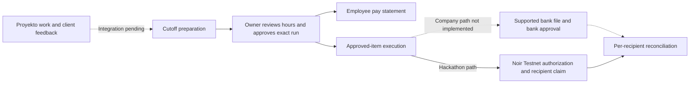

# Snapp

**Agentic Work Verification & Payment Orchestration**

> Pay fast, in a snap.

From verified deliverables to streamlined payouts. One platform for teams, clients, and business owners.

**Repository:** [JoshuaHM-p4/Snapp](https://github.com/JoshuaHM-p4/Snapp)

**Live website:** https://snapp-prodigitality.vercel.app (API: https://snapp-server.onrender.com/api/health)  
**Demo video (2 min):** `TBD`  
**Pitch deck:** [deck/Snapp-Hackathon-Deck.pdf](deck/Snapp-Hackathon-Deck.pdf) (PPTX source: [deck/Snapp-Hackathon-Deck.pptx](deck/Snapp-Hackathon-Deck.pptx); public share link `TBD`)  
**Team:** [JCarloZ24 (JC)](https://github.com/JCarloZ24) (UI/UX + Frontend), [Stobeeney](https://github.com/Stobeeney) (API Integration), [aidantiu](https://github.com/aidantiu) (Integration + Deployment), [JoshuaHM-p4](https://github.com/JoshuaHM-p4) (Founder/Fullstack + Noir Setup, Development & Testing). **Discord handles:** TBD (do not guess).

## Problem
In our small digital services company, the consultant/owner reviews hours per employee and project for **1–15 and 16–end-of-month** cutoffs. He then opens the bank, copies each employee's account details and pay amount, sends the transfer and completes the bank's authorization steps—one employee at a time. That repetitive disbursement is the main bottleneck.

Employees also lack a clear breakdown to verify pay against hours and rates. The owner sees recorded hours and task lists without a consolidated view of actual outputs, client comments, revision requests and acceptance.

The company already uses **Proyekto** for project/client collaboration, documents, roadmaps, Gantt charts and invoicing. Rebuilding those tools is not the solution.

## Solution
Snapp targets cutoff preparation, manual owner review, employee pay transparency and approved-run execution alongside Proyekto. Milestones bundle task/deliverable evidence and client evaluations; they are not the default unit of hourly employee pay. The owner retains hours review and final release authority. The agent cannot set wages or change approved recipients and amounts.

**Current status:** fictional milestone previews and Velo adapters remain, alongside separate controlled **local Noir Testnet tooling**. The local CLI supports exact owner-signed single-item consent, owner setup, agent authorization, merchant claim, SQLite reconciliation and **Snapp Autopilot**: a Payment Eligibility Engine (deterministic rules) plus a Payout Risk & Review Agent (Jev) that decides when an owner-approved item is executed through Noir. It is not an authenticated payroll workflow. Proyekto integration, cutoff review, client-evaluation history, employee statements, approved pay runs, RBAC and bank payouts are **not implemented**. Live Testnet proof: see [Testnet proof](#testnet-proof).

### Target workflow
1. Reference Proyekto projects, time entries and versioned deliverables. Record client comments, revision requests and acceptance against the evaluated version. Integration access still needs verification.
2. Prepare the cutoff with submitted hours, agreed rates and output context. The owner manually reviews and approves hours per employee/project.
3. Give each employee their own calculation: submitted/approved hours, rates, explained adjustments, expected pay and a discrepancy channel.
4. Owner approves an immutable pay-run version with exact verified recipients, amounts, currency/asset and total. Changes require reapproval.
5. Execute only approved items and reconcile each recipient independently. Never replay an entire partly paid run or blindly retry an uncertain transfer.

Client acceptance informs work review; it does **not** automatically determine whether hours-based wages are owed. Follow the actual compensation agreement and applicable law. Client invoice payment is separate from employee pay eligibility.

### Company path versus hackathon path
- **Company adoption:** verify the chosen bank's existing bulk-disbursement facility first, then generate its supported upload file from an approved run. Bank integration is not implemented. Preserve bank-native authorization; do not automate OTP entry or promise one authorization for every bank.
- **Hackathon demonstration:** use separate local tooling for an exact owner-approved Testnet experiment, not a server pay-run endpoint. Owner signs consent and device/policy/funding steps; agent checks eligibility then prepares/signs/submits the SDK `authorize` operation; merchant separately signs `claim`. Local allowlisting and cumulative-device reservations are not a cutoff/run model. Authorization is not receipt.
- **Optional client collections:** Velo checkout and signed-event verification remain separate from pay-run release and Noir funding; event dedupe and retrieval-based reconciliation are implemented server-side; a real Velo project run is still pending. Velo's current [upstream scope](https://github.com/Velo-Ecosystem-Collection/Velo/blob/main/packages/velo-sdk/README.md#release-scope) is Testnet only, with no Mainnet or external settlement support. Neither integration sends PHP to employee bank accounts.

The differentiation to validate is work-to-payment traceability, not novel payroll rails. [BPI BizLink](https://www.bpi.com.ph/institutional-banking/cashflow-management/bizlink) already documents transaction-file upload and approval controls; [Sprout Payroll](https://sprout.ph/product/payroll-management/) documents timekeeping, employee payslips and bank-disbursement file generation. Company eligibility, costs and bank coverage need verification.

## How the agentic payment works
The owner decides **how much** and **to whom**; the agent decides **whether and when** that approved item is executed. No human clicks "pay" in the autopilot path.

1. **Owner approval (human).** The owner signs an exact manifest (recipient, amount, limits, expiry, asset, contracts) with `approve`. The agent cannot change any of those values.
2. **Payment Eligibility Engine (deterministic, [payout-decision.ts](packages/agent/src/payout-decision.ts)).** For a payout record (the milestone, its payout date and the client's review text) it checks, in order: approval valid and unexpired → recipient/amount identical to the signed manifest → `evaluateMilestone` ([index.ts](packages/agent/src/index.ts)) says `pay` → payout date reached → autopilot not disabled → live Noir device/policy/escrow and `checkPayment` agree. Any failure yields `DEFER` (temporary: not yet approved, not due, insufficient escrow, Jev unavailable) or `ESCALATE` (needs a human: dispute, failed evidence, changed recipient/amount, expired approval, setup conflict).
3. **Payout Risk & Review Agent (Jev, [payout-risk.ts](packages/agent/src/payout-risk.ts)).** Only if everything above passes, the agent sends the deliverable title, acceptance criteria and the review text to Jev through the Vercel AI SDK `experimental_decide` (`ai@7.0.163`): direct `@ai-sdk/typesafe-ai` with the model pinned to `jev-1.14.0` when `TYPESAFE_AI_API_KEY` is set, otherwise Vercel AI Gateway model `typesafe-ai/jev` with `AI_GATEWAY_API_KEY` and asks two structured questions: which review route fits (`routine | pending | escalate`) and whether an unresolved concern exists. Thresholds sit on the probability of the acted-on option (`routine ≥ 0.90`, concern ≤ 0.10 → execute; `pending ≥ 0.70` → defer; otherwise escalate). Jev can only make a payout stricter, never approve one; if it is unavailable the verdict is `DEFER`. No addresses, amounts, hashes or names are sent.
4. **Execution (Noir SDK).** On `EXECUTE`, the same journaled `authorize` path runs: allowlist, cumulative-device budget under a SQLite lock, SDK `prepare` → agent-key signature → hash persisted **before** broadcast → `submit`. A recorded operation is never replayed.
5. **Audit.** Every verdict is appended to an immutable `decisions` table with its stage, reason, input hash and Jev probabilities; `evidence` prints them next to the transaction records. The merchant still signs `claim` separately.

Commands: `assess` (read-only verdict, no signer) and `autopilot --live --confirm <digest> [--every <seconds>]` (verdict + execution, re-evaluating deferred items on an interval). `SNAPP_AUTOPILOT_DISABLED=true` stops new executions. Thresholds are untuned starting points, not validated safety guarantees; a real Jev call requires `TYPESAFE_AI_API_KEY` or `AI_GATEWAY_API_KEY`. Live Jev answers were observed through Vercel AI Gateway on three sample reviews (accepted → EXECUTE, open revision → DEFER, dispute → ESCALATE); Vercel requires a card on file before the gateway serves requests. Live autopilot execution on Testnet still needs the owner setup prerequisites below.

## Architecture
**Current implementation** (apps, agent, Noir contracts, Velo):
```mermaid
flowchart LR
  subgraph web[apps/web]
    UI[React dashboard: fixture projects, read-only preview]
  end
  subgraph server[apps/server]
    API[Express API]
    WH[/api/webhooks/velo]
    CS[(collections.sqlite)]
  end
  subgraph agent[packages/agent]
    ELIG[Payment Eligibility Engine]
    JEV[Payout Risk and Review Agent: Jev]
    CLI[Noir CLI: approve, setup, autopilot, claim, reconcile]
    JR[(noir-testnet.sqlite journal)]
  end
  UI --> API
  API --> ELIG
  API -->|checkout| Velo[Velo Testnet]
  Velo -->|signed webhook| WH --> CS
  WH -->|paymentIntents.retrieve| Velo
  Owner([Owner shell]) -->|sign manifest, setup| CLI
  CLI --> ELIG --> JEV --> CLI
  CLI --> JR
  CLI -->|Noir SDK: registerDevice, registerAgent, fundEscrow, authorize, claim| Noir[Noir Testnet contracts]
  Merchant([Merchant shell]) -->|claim| CLI
```
Velo and Noir never call each other; client collections do not fund escrow or release pay. The agent runs in the owner-controlled CLI, not the browser; no key is held by `apps/web`.

**Target product flow** (not yet implemented):

The second diagram is the target, not the current implementation. See [architecture notes](docs/ARCHITECTURE.md), [PRD](PRD.md), [current API](docs/API.md) and [integration guide](docs/INTEGRATIONS.md).

## Noir integration
- Pinned and installed: `@noirx402/agent-sdk@0.3.0` and `@stellar/stellar-sdk@16.0.1`. The installed SDK was compared with source commit `704f701a017b0b13f79898d2597df8c11fd4fa94`.
- Fixed **Testnet only** configuration: native XLM and SDK `device_registry`, `agent_registry`, `payment_escrow` IDs. All contract calls use the official Noir SDK; **no custom contracts**, RPC overrides or Mainnet support.
- Source: [SDK preparation/signing boundary](packages/agent/src/noir.ts), [local CLI](packages/agent/src/noir-cli.ts), [SQLite journal](packages/agent/src/noir-store.ts), [shared preview decision rules](packages/agent/src/index.ts).
- Root entry point: `npm run noir -- <command>`. Commands are `plan`, `doctor`, `approve`, `setup --step device|policy|fund`, `check`, `authorize`, `claim`, `reconcile`, `evidence`, `assess`, `autopilot`; see [operator sequence](SETUP.md). There is **no HTTP Noir execution route**: the former milestone approval route returns 404, without a replacement.
- Owner approval signs the exact public manifest/configuration digest. SQLite at repository-root `.data/noir-testnet.sqlite` serializes cumulative-device authorization reservations and persists transaction identity before broadcast. A recorded operation cannot be retried/reset, even if failed; uncertain outcomes are reconciled, never replayed. `--db` explicitly selects another journal; copying/deleting journals defeats local deduplication.
- Merchant claim collects **all** pending funds for that merchant/token, with explicit pending-stroops confirmation; it is not one receipt per approved item. Evidence separates recorded hashes, confirmed transactions and matching authorization/claim events.
- **Contract ID conflict warning:** pinned SDK/repository agreement and a read-only Testnet RPC check do **not** resolve the earlier form's differing IDs. Independent organizer/deployment verification is still required; see [exact IDs / action plan](docs/INTEGRATIONS.md). Set `NOIR_TESTNET_CONTRACTS_CONFIRMED=true` only after that verification, never just to bypass a gate.
- Live writes additionally require `--live`, exact digest confirmation, valid local consent, a verified merchant allowlist and three distinct, manually funded Testnet role wallets. Secrets are inherited only in private role-specific shells, not arguments, chat, browser or server `.env`. No keys or funds are created automatically.

## Velo integration
- This starter declares `@carts1024/velo-sdk@alpha` (resolved version unverified). The current upstream README describes stable `1.0.0`; this documentation update does not upgrade or validate the dependency. Compare actual exports before implementation.
- Checkout: [server Velo adapter](apps/server/src/payments.ts), [protected checkout endpoint](apps/server/src/index.ts).
- Raw signed webhook verification: [webhook route](apps/server/src/index.ts) using `Velo.webhooks.verify`.
- Collections store: [collections.ts](apps/server/src/collections.ts). Checkout records the intent; webhooks are deduped on `event.id` and status is set only from `paymentIntents.retrieve`. `GET /api/collections` lists them. Verified with self-signed events and one real Velo Testnet collection: intent created by this server, paid on-chain ([tx fe057622…](https://stellar.expert/explorer/testnet/tx/fe05762287ed2aaf7b87cc42f2bbbe749a0e09d52ba28463f4d04bba82d44045)), `paid` confirmed from Velo's API. Live webhook delivery (which supplies `txHash`) needs the deployed server URL. `POST /api/collections/:id/reconcile` (admin) re-checks a missed delivery.

## Testnet proof
**Noir (agent payment), Stellar Testnet, Nov 6 2026.** One owner-approved 1.5 XLM item, decided and executed by Snapp Autopilot, collected by the merchant. Each transaction was confirmed by RPC and its contract event decoded and matched (device hash, merchant, amount) by `npm run noir -- reconcile`.

| Step | Signer | Ledger | Transaction |
|---|---|---|---|
| registerDevice | owner | 5589778 | [94ca07a7…9a72](https://stellar.expert/explorer/testnet/tx/94ca07a78a952786bee142cdac68fdb26f409a1422e04a6108e03f17e2539a72) |
| registerAgent (cap 2 XLM, native, expires 2026-11-20) | owner | 5589783 | [5b0f759a…6eb1](https://stellar.expert/explorer/testnet/tx/5b0f759a9b61cd96791df95821900f22c93fec4ed3e796ab3bf314c52c0a6eb1) |
| fundEscrow (5 XLM) | owner | 5589790 | [eceed372…033f](https://stellar.expert/explorer/testnet/tx/eceed372739dc3c81e7bd395374bff33c1d2f3a12b9d5ec90a138ba504da033f) |
| **authorize 1.5 XLM → merchant** (agent decision: eligibility passed, Jev `routine` P=1.00, concern 0.03 → EXECUTE) | **agent** | 5589865 | [92713462…5c5d](https://stellar.expert/explorer/testnet/tx/9271346277a3a9b69763ba00af1405fe6f5a72f9965847aa7b40c6735b275c5d) |
| claim (aggregate 15,000,000 stroops) | merchant | 5589949 | [e2bdbb00…2bb4](https://stellar.expert/explorer/testnet/tx/e2bdbb00816474d5174cea16ea7993422318fd69a534828f7587f479c5ba2bb4) |

Roles: owner `GCGBYAA7…UKCBX`, agent `GAOBNDIG…5X6T`, merchant `GBXQJACH…VKE6`; device hash `b616f1cc…7185`. After the claim: merchant pending 0, escrow 3.5 XLM, merchant balance +1.5 XLM. The agent decision log (both verdicts, Jev probabilities, input hash) is in the local journal and printed by `evidence`.

**Velo (client collection):** [fe057622…d44045](https://stellar.expert/explorer/testnet/tx/fe05762287ed2aaf7b87cc42f2bbbe749a0e09d52ba28463f4d04bba82d44045): 0.5 XLM paid through a checkout this server created; Velo reported `paid`. This is a client payment, not the agent's Noir payment. Collect genuine [Stellar Expert Testnet](https://stellar.expert/explorer/testnet) links and separate confirmed setup, authorization and merchant-claim ledgers/events after the live prerequisites are met. Neither fixture previews, synthetic SDK transport checks, pending balances nor a merely recorded hash is settlement proof.

## Repo structure
```
apps/web/             React frontend + route views
apps/server/          Express API, webhook, Velo checkout
packages/agent/       Decision engine + controlled local Noir CLI and SQLite journal
packages/shared/      Cross-app types
docs/                 PRD references, UX, payment design, checklist
scripts/              Local smoke check
.github/workflows/     CI
```

## Run it locally
1. Install Node 22.23.4+ (supported 22 release) and Git; optional Noir Chrome extension / Testnet wallets for real SDK flows.
2. At root: `npm install`.
3. `cp apps/server/.env.example apps/server/.env` and keep `DEMO_MODE=true`.
4. Run `npm run dev`: web `http://localhost:5173`, server `http://localhost:4000`.
5. Run `npm run typecheck && npm test && npm run build`. See full [SETUP.md](SETUP.md).
6. Deploy: web on Vercel (Root Directory `apps/web`, committed [`apps/web/vercel.json`](apps/web/vercel.json)) with `VITE_API_BASE` set; server on Render from [`render.yaml`](render.yaml) with `WEB_ORIGIN`/`PUBLIC_WEB_URL` pointing at the Vercel URL. Steps in [SETUP §6a](SETUP.md#6a-deploy-public-url-is-a-submission-requirement).

## Environment variables
| Name | What it is | Where to get it |
|---|---|---|
| `PORT`, `WEB_ORIGIN`, `PUBLIC_WEB_URL` | Server config, safe origins | Set locally / hosting |
| `DEMO_MODE` | Prevent server Velo checkout (`true` by default); does not gate the separate Noir CLI | Local override |
| `ADMIN_API_TOKEN` | Temporary privileged test API token; not production login | Create random local secret |
| `VELO_API_KEY` | Velo Testnet checkout API | [Velo dashboard](https://www.velo-build.dev) |
| `VELO_WEBHOOK_SECRET` | Velo signature verification | Velo webhook config |
| `NOIR_OWNER_SECRET`, `NOIR_AGENT_SECRET`, `NOIR_MERCHANT_SECRET` | Separate local CLI role signers; read only by the command needing that role | Private inherited role-specific shell environment; never commit |
| `ALLOWED_MERCHANT_ADDRESSES` | Independent verified merchant allowlist for local tooling | Operator-approved public addresses |
| `NOIR_TESTNET_CONTRACTS_CONFIRMED` | Local operator attestation after independent contract verification; default `false` | See `packages/agent/.env.example`; never auto-loaded |
| `TYPESAFE_AI_API_KEY` or `AI_GATEWAY_API_KEY` | Jev (Payout Risk & Review Agent); agent shell only. Direct key is preferred; gateway key is the fallback. No key makes every autopilot verdict `DEFER` | [TypeSafe console](https://console.typesafe.ai/keys) (sign-ups currently waitlisted) or [Vercel AI Gateway](https://vercel.com/docs/ai-gateway/getting-started) (requires a card on file) |
| `SNAPP_AUTOPILOT_DISABLED` | Emergency stop: `true` defers every autopilot evaluation | Local override |
| `VITE_API_BASE` | Public API server origin for split deployments | Set on web host; empty for dev proxy |

## Screenshots
**TBD:** owner cutoff review, employee calculation/discrepancy view, exact-run approval, per-recipient status, separate Velo collection, and genuine Noir authorization/claim proof. These are target screenshots, not claims that the screens exist. Do not use fake receipts.

## Pitch deck
11 slides for the Velo x Noir Agentic Payment Hackathon, built from `deck/build.js` (`cd deck && npm install && node build.js`; needs Python 3 with Pillow for the tilted screenshot frames). Screenshot and logo slots still to fill are listed in [docs/DECK_ASSETS_NEEDED.md](docs/DECK_ASSETS_NEEDED.md); the plan is in [docs/PITCH_DECK_PLAN.md](docs/PITCH_DECK_PLAN.md).

## What's next
Build the Proyekto-linked cutoff/review model, versioned client evaluations, private employee statements and immutable owner approval first. Add authenticated, durable per-item execution and reconciliation before exposing money-moving controls. Demonstrate owner-approved Testnet execution and merchant claim through Noir; demonstrate Velo collection separately, not as automatic payroll funding.

For company use, evaluate supported bank bulk-disbursement and existing payroll tools before building a custom bank API. Actual bank execution and production payroll compliance remain outside the Testnet hackathon scope. Brand styling stays on hold until Prodigitality approves it.

## Credits
Official project repos: [Noir](https://github.com/noirx402/noir) and [Velo](https://github.com/Velo-Ecosystem-Collection/Velo). SDK integration patterns follow the *Velo x Noir Agentic Payment Hackathon — Builder Handbook*, updated Nov 5, 2026. Uses React, Vite, Tailwind, Express, TypeScript and Stellar. Concept adapted for [Prodigitality](https://prodigitality.net/services). All code in this starter is a fresh scaffold, not a clone of either vendor repo.

> **Controlled-tooling validation:** installed Noir 0.3.0/Stellar 16.0.1 and pinned source checked on Node 22.23.4. Twenty focused Noir tests and all 21 workspace tests passed, along with scaffold checks, agent typecheck, actual offline CLI consent/evidence/gate smoke and real-SDK synthetic-transport persistence/restart smoke. Read-only `doctor` confirmed Testnet configuration with `contractsAttested:false`. Real server health/projects/preview returned 200, removed approval POST returned 404, and browser preview showed three holds/local-tooling prose without errors. Root typecheck and full build pass after the Velo webhook payload fix. Live authorization/claim and deployment remain unverified. See [verification details](docs/CHECKLIST.md#exercised-controlled-tooling-checks--not-live-gates).
