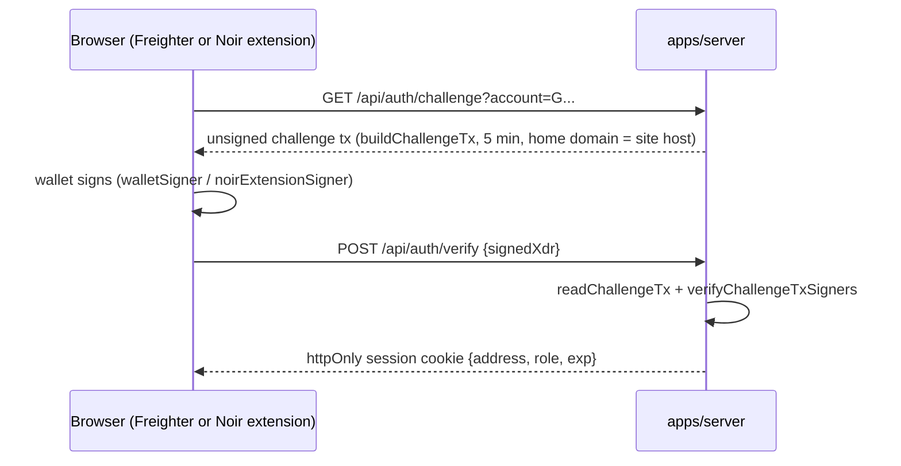

# Wallet sign-in and in-browser signing: design note and plan

Status: proposal, not implemented. Written Nov 8, 2026, after the hackathon submission, for the pitch week and after.

## Why

The dashboard has no identity. Every visitor sees the same fixture data, the Payment agent page shows a recorded run, and anything that moves money happens in an operator terminal with role secrets in environment variables. The product story is three people with different views (owner, developer, client), and the handbook's "real-world potential" criterion is exactly the gap this closes. Signing in with a Stellar wallet gives each person a view keyed to their own address, and later lets the owner and the recipient sign Noir operations from the browser instead of a shell. No passwords, no secrets on the server.

## What stays fixed

- The agent key never enters a browser. It stays server-side or in the operator shell.
- Money moves only through the official Noir SDK and the existing journal (hash persisted before broadcast, no replay, cumulative budget). Browser signing changes *who holds the pen*, not the path.
- Testnet only. Velo stays a separate client lane.
- Roles come from the signed manifest (owner, agent, merchant public keys), not from a user table.

## Design

### 1. Sign-in (SEP-10 style challenge)

`buildChallengeTx`, `readChallengeTx` and `verifyChallengeTxSigners` are in `@stellar/stellar-sdk` already installed. The server needs one new secret, `AUTH_SERVER_SECRET` (a Stellar keypair used only to sign challenges; it holds no funds), plus a session signing key. Sessions are short (hours) and httpOnly; no JWT library needed, an HMAC-signed cookie is enough.

### 2. Roles from addresses

| Session address matches | Role | Sees |
|---|---|---|
| manifest `owner` | owner | Cutoff review, approvals, setup status, full Proof |
| manifest `merchant` | developer | Own statement, own pending/claimed amounts, claim action |
| Velo `payerAddress` on a recorded collection | client | Own invoices and collection status |
| anything else | visitor | Read-only demo with fixture data (today's behaviour) |

The manifest set lives in the journal, which today sits on the operator's machine. For roles to resolve on the server, the journal (or a read replica of `experiments` and `operations`) moves to the server with a persistent disk or a managed Postgres. That is the one real infrastructure change.

### 3. In-browser signing (second step, optional)

`prepareSigned` already accepts any `NoirSigner`. With the journal on the server:

- **Owner:** `approve` becomes a browser action (sign the manifest bytes with the wallet; Freighter supports `signMessage`, the Noir extension signs via `window.noir.stellar`). Setup steps use `prepare` on the server, sign in the wallet, `submit` on the server. The server never sees the owner key.
- **Merchant:** `check` and `claim` from the statement page, same prepare/sign/submit split, with the explicit pending-stroops confirmation kept as a UI step.
- **Agent:** unchanged. `autopilot` keeps running from the operator shell (or later a server job gated by the same journal and kill switch).

The CLI stays as the reference implementation and the recovery path.

## Plan

| Step | Work | Size |
|---|---|---|
| 0 | Persistent storage on Render (disk at `/opt/render/project/src/.data`, Starter plan) or Neon/Supabase Postgres; move `collections.sqlite` and a server copy of the Noir journal | half day |
| 1 | `apps/server`: `/api/auth/challenge`, `/api/auth/verify`, `/api/auth/logout`, `/api/me`; HMAC session cookie; `requireRole()` middleware; tests with deterministic keypairs | 1 day |
| 2 | `apps/web`: Connect wallet button (Stellar Wallets Kit covers Freighter, xBull, Albedo; Noir extension via `noirExtensionSigner`); session state; role-gated routes; "Your address is not part of a run" fallback | 1 day |
| 3 | Owner view: approvals and setup status read from the server journal; merchant view: own pending and claimed amounts | 1 day |
| 4 | Browser signing for owner `approve` and merchant `claim` through the prepare/sign/submit split; agent stays in the shell | 1 to 2 days |
| 5 | Docs, `.env.example`, checklist, threat notes (replay of challenge, session fixation, CORS to the Vercel origin only) | half day |

Steps 0 to 3 make a convincing live demo for the pitch (sign in as owner, see your run; sign in as the developer, see your statement). Step 4 is the one that changes how payments are signed and should wait until after the pitch unless time allows.

## Risks

- A wallet address proves control of a key, not identity. Role mapping is only as good as the manifest the owner signed. Fine for a demo; a company deployment needs the owner to register addresses deliberately.
- Freighter prompts can confuse first-time users on stage. Rehearse with the exact wallet and network selected.
- Moving the journal server-side makes the server a target. Keep the agent secret out of it, keep `ADMIN_API_TOKEN` rotated, and keep Testnet only until auth is reviewed.

## Not in scope

Email or password accounts, multi-tenant organisations, Proyekto SSO, payroll data, Mainnet.
